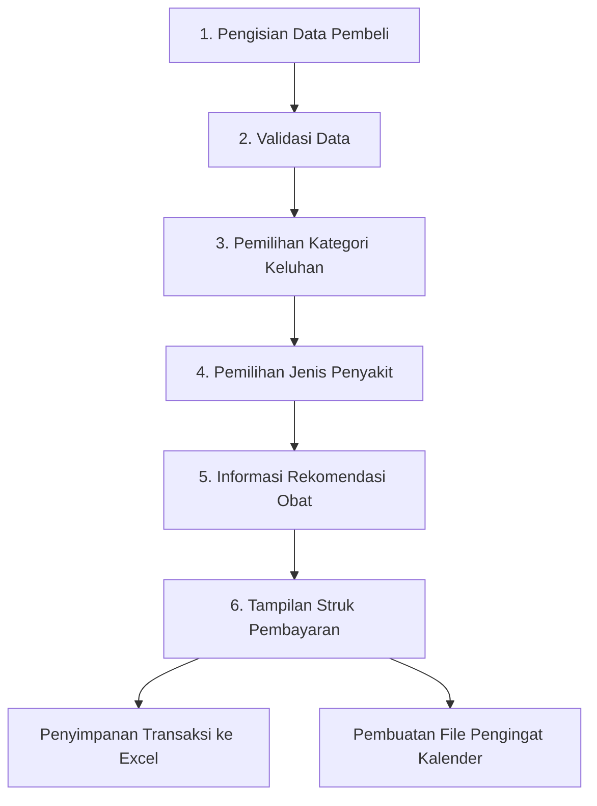

# Proyek Pemrograman Dasar: Sahabat Kesehatan Digital
### Aplikasi Apotek Digital dan Pengingat Konsumsi Obat

## Anggota Kelompok
| No. | Nama | NIM | 
|:---:|---|---|
| 1 | Yanaka Sofia Pardede | 24031554065 |
| 2 | Annisa Ramadhani | 24031554206 |

## Identitas dan Konteks Akademik

| Informasi | Keterangan |
|---|---|
| Mata Kuliah | Pemrograman Dasar |
| Jenis Proyek | Aplikasi Desktop Berbasis GUI |
| Bahasa Pemrograman | Python 3.14 |
| Program Studi | S1 Sains Data |
| Fakultas | Matematika dan Ilmu Pengetahuan Alam |

> **Disclaimer:** Proyek ini merupakan prototipe pembelajaran untuk keperluan demonstrasi pemrograman. Seluruh data penyakit, rekomendasi obat, harga, dosis, dan jadwal konsumsi bersifat statis (*predefined*) dan telah ditentukan di dalam kode program. Informasi yang ditampilkan bukan merupakan pengganti diagnosis medis, resep dokter, maupun konsultasi dengan tenaga kesehatan profesional.

## Deskripsi Proyek

**Sahabat Kesehatan Digital** merupakan aplikasi desktop berbasis **Python dan Tkinter** yang dikembangkan untuk menyimulasikan layanan apotek digital melalui antarmuka grafis (*Graphical User Interface* / GUI).

Aplikasi ini dirancang dengan sistem navigasi bertahap (*multi-frame*), sehingga pengguna dapat mengikuti proses layanan mulai dari pengisian identitas pembeli, pemilihan kategori keluhan, pemilihan jenis penyakit, hingga memperoleh informasi rekomendasi obat dan menampilkan struk pembayaran.

Selain menyediakan simulasi layanan apotek digital, aplikasi ini memiliki fitur penyimpanan data transaksi secara otomatis ke dalam file Excel (`.xlsx`) serta pembuatan file kalender (`.ics`) sebagai pengingat jadwal konsumsi obat.

Proyek ini mengimplementasikan beberapa konsep pemrograman dasar, khususnya pemrograman berorientasi objek (OOP), pengelolaan struktur data, validasi input, pengelolaan berkas, serta pengembangan antarmuka grafis menggunakan Python.

## Tujuan Proyek

1. Mengimplementasikan konsep pemrograman dasar menggunakan bahasa Python dalam pengembangan aplikasi desktop.
2. Menerapkan konsep pemrograman berorientasi objek (OOP) untuk mengelola struktur dan fungsionalitas aplikasi.
3. Mengembangkan antarmuka grafis interaktif menggunakan Tkinter dengan sistem navigasi bertahap.
4. Menerapkan validasi input untuk memastikan data pengguna sesuai dengan ketentuan yang ditetapkan.
5. Mengimplementasikan struktur data berupa *list* dan *dictionary* untuk mengelola kategori keluhan, informasi penyakit, dan rekomendasi obat.
6. Mengintegrasikan penyimpanan data transaksi ke dalam file Excel.
7. Mengembangkan fitur pembuatan file kalender sebagai pengingat jadwal konsumsi obat.

## Fitur Utama Aplikasi

### 1. Pengisian dan Validasi Data Pembeli

Pada halaman awal aplikasi, pengguna diminta mengisi beberapa informasi dasar, yaitu:

- Nama pembeli.
- Umur.
- Berat badan (kg).
- Tinggi badan (cm).

Aplikasi menerapkan validasi input untuk memastikan data yang dimasukkan sesuai dengan ketentuan:

- Nama hanya menerima karakter alfabet dan spasi.
- Umur, berat badan, dan tinggi badan hanya menerima karakter angka.
- Seluruh kolom wajib diisi sebelum pengguna melanjutkan ke tahap berikutnya.
- Berat badan dan tinggi badan diperiksa agar dapat dikonversi ke tipe data `float`.

Validasi dilakukan melalui mekanisme `validate="key"` dan pemeriksaan kembali ketika tombol **Lanjut** ditekan.

### 2. Pemilihan Kategori Keluhan dan Jenis Penyakit

Aplikasi menyediakan **13 kategori keluhan utama** yang dapat dipilih pengguna sesuai dengan kategori yang tersedia.

| No. | Kategori Keluhan | Jenis Penyakit |
|---|---|---|
| 1 | Kulit | Jerawat, Cacar Air, Kudis, Kurap, Kutil |
| 2 | Batuk | Batuk Berdahak, Batuk Tidak Berdahak |
| 3 | Pernapasan | Asma, Flu, ISPA |
| 4 | Sakit Kepala | Sakit Kepala Tegang, Sakit Kepala Cluster |
| 5 | Gigi | Gigi Berlubang, Periodontitis |
| 6 | Sendi | Osteoarthritis |
| 7 | Otot | Myositis, Fibromyalgia |
| 8 | Diabetes | Diabetes Tipe 1, Diabetes Tipe 2 |
| 9 | Penyakit Kelamin | Klamidia, Herpes Genital |
| 10 | Pencernaan | Maag, Kram Perut |
| 11 | Darah | Anemia |
| 12 | Saraf | Parkinson, Multiple Sclerosis |
| 13 | Penyakit Dalam | Jantung |

Setelah memilih kategori keluhan, pengguna dapat memilih jenis penyakit yang tersedia. Setiap jenis penyakit dilengkapi ilustrasi yang disimpan dalam folder `assets/diseases/` serta tombol **Pilih** untuk melanjutkan ke halaman informasi rekomendasi obat.

### 3. Informasi Rekomendasi Obat

Setelah memilih jenis penyakit, aplikasi menampilkan informasi yang berkaitan dengan rekomendasi obat berdasarkan data yang telah ditentukan di dalam program.

Informasi yang ditampilkan meliputi:

- Nama obat.
- Dosis atau frekuensi konsumsi sesuai data yang tersedia.
- Harga obat dalam Rupiah.
- Waktu konsumsi obat.

Data rekomendasi dikelola menggunakan struktur `dictionary` bernama `rekomendasi`, yang memuat 27 pemetaan kategori keluhan dan jenis penyakit.

### 4. Tampilan Struk Pembayaran

Pada tahap akhir, aplikasi menampilkan struk pembayaran yang berisi ringkasan informasi pembeli dan obat yang dipilih.

Struk ini menjadi bagian dari simulasi proses transaksi apotek digital sebelum pengguna menyelesaikan sesi aplikasi.

### 5. Penyimpanan Data Transaksi ke Excel

Aplikasi menyediakan fitur penyimpanan transaksi secara otomatis menggunakan class `ExcelDataManager` dengan bantuan library **OpenPyXL**.

Data transaksi disimpan ke dalam file Excel dengan nama default:

`Pembeli Apotek Digital.xlsx`

Informasi yang disimpan meliputi:

| Kolom | Keterangan |
|---|---|
| Nama | Nama pembeli |
| Umur | Umur pembeli |
| Berat Badan | Berat badan dalam kilogram |
| Tinggi Badan | Tinggi badan dalam sentimeter |
| Keluhan | Kategori atau informasi keluhan |
| Obat | Nama obat yang dipilih |
| Harga | Harga obat |

Jika file Excel belum tersedia, aplikasi akan membuat workbook baru beserta baris judul kolom. Jika file sudah tersedia, data transaksi baru akan ditambahkan (*append*) ke dalam lembar kerja aktif.

### 6. Pembuatan File Pengingat Kalender

Aplikasi juga menyediakan fitur pembuatan file kalender menggunakan class `CalendarManager` dengan bantuan library **iCalendar**.

Fitur ini bekerja dengan membaca jadwal konsumsi obat yang tersimpan dalam data rekomendasi, kemudian mengubah setiap waktu konsumsi menjadi sebuah kegiatan kalender.

Mekanisme pembuatan pengingat meliputi:

1. Membaca jadwal konsumsi obat dari variabel `waktu_konsumsi`.
2. Memisahkan setiap waktu konsumsi berdasarkan tanda koma.
3. Membuat kegiatan kalender untuk setiap waktu yang telah ditentukan.
4. Mengatur durasi setiap kegiatan selama 30 menit.
5. Menggunakan tanggal saat file dibuat sebagai dasar penjadwalan.
6. Menyimpan hasilnya dalam format file kalender `.ics`.

Nama file yang dihasilkan mengikuti format:

`<Nama>_pengingat_obat.ics`

File tersebut dapat digunakan pada aplikasi kalender yang mendukung format iCalendar.

## Alur Kerja Aplikasi

Aplikasi Sahabat Kesehatan Digital memiliki enam tahapan utama yang saling terhubung melalui sistem navigasi antarmuka grafis.



### Penjelasan Tahapan

| Tahap | Proses | Keterangan |
|---|---|---|
| 1 | Pengisian Data Pembeli | Pengguna memasukkan nama, umur, berat badan, dan tinggi badan. |
| 2 | Validasi Data | Sistem memeriksa kelengkapan dan kesesuaian format input. |
| 3 | Pemilihan Kategori Keluhan | Pengguna memilih satu dari 13 kategori keluhan. |
| 4 | Pemilihan Jenis Penyakit | Sistem menampilkan daftar penyakit beserta ilustrasinya. |
| 5 | Informasi Rekomendasi Obat | Sistem menampilkan nama obat, dosis, harga, dan waktu konsumsi berdasarkan data yang tersedia. |
| 6 | Tampilan Struk Pembayaran | Sistem menampilkan ringkasan transaksi serta menjalankan proses penyimpanan data dan pembuatan pengingat kalender. |

## Arsitektur dan Implementasi Teknis

Pengembangan aplikasi menerapkan beberapa konsep pemrograman dasar yang diintegrasikan ke dalam struktur program.

| Komponen / Konsep | Implementasi |
|---|---|
| Pemrograman Berorientasi Objek (`ApotekDigital`) | Mengelola state aplikasi, pembuatan frame, navigasi antarmuka, tampilan informasi, dan penanganan peristiwa (*event handling*). |
| Pengelolaan Data Transaksi (`ExcelDataManager`) | Mengelola proses pembuatan, pembukaan, dan penyimpanan data transaksi ke dalam file Excel. |
| Pengelolaan Kalender (`CalendarManager`) | Mengelola pembuatan kegiatan kalender dan ekspor jadwal ke format iCalendar (`.ics`). |
| Antarmuka Grafis (Tkinter) | Membangun tampilan aplikasi berbasis GUI dengan sistem navigasi bertahap. |
| Validasi Input | Memeriksa karakter, kelengkapan, dan tipe data yang dimasukkan pengguna. |
| Struktur Data | Menggunakan `list` dan `dictionary` untuk mengelola kategori keluhan, informasi penyakit, dan rekomendasi obat. |
| Pengelolaan Direktori (`os.path`) | Menggunakan `BASE_DIR`, `BACKGROUND_DIR`, dan `DISEASE_DIR` untuk mengelola lokasi aset dan berkas aplikasi. |

## Panduan Menjalankan Proyek

### 1. Mengunduh Repository

Clone repository menggunakan perintah berikut:

```bash
git clone https://github.com/yanakapardede/apotek-digital-pengingat-obat.git
```

Masuk ke direktori proyek:

```bash
cd apotek-digital-pengingat-obat
```

### 2. Membuat Virtual Environment

Buat lingkungan virtual untuk mengelola dependensi proyek.

**Windows (CMD / PowerShell):**

```bash
python -m venv .venv
.venv\Scripts\activate
```

**macOS / Linux:**

```bash
python3 -m venv .venv
source .venv/bin/activate
```

### 3. Menginstal Library

Instal seluruh library yang dibutuhkan melalui file `requirements.txt`:

```bash
pip install -r requirements.txt
```

### 4. Menjalankan Aplikasi

Jalankan aplikasi menggunakan perintah:

```bash
python app.py
```

Setelah berhasil dijalankan, jendela aplikasi Sahabat Kesehatan Digital akan terbuka dan pengguna dapat mengikuti tahapan layanan melalui antarmuka yang tersedia.

## Catatan dan Keterbatasan Prototipe

Beberapa hal yang perlu diperhatikan dalam penggunaan aplikasi ini adalah:

- **Data Statis:** Informasi penyakit, rekomendasi obat, harga, dan jadwal konsumsi telah ditentukan di dalam kode program menggunakan struktur `dictionary`. Aplikasi belum menggunakan database eksternal.
- **Bukan Sistem Diagnosis Medis:** Aplikasi tidak melakukan diagnosis penyakit maupun perhitungan dosis klinis berdasarkan berat badan atau tinggi badan pengguna.
- **Penjadwalan Kalender:** File `.ics` menggunakan tanggal saat proses pembuatan file dengan durasi kegiatan default selama 30 menit untuk setiap jadwal konsumsi.
- **Penyimpanan Lokal:** Data transaksi dan file pengingat disimpan secara lokal pada perangkat tempat aplikasi dijalankan.
- **Pengembangan Sistem:** Aplikasi masih berupa prototipe pembelajaran dan dapat dikembangkan lebih lanjut melalui integrasi database, pengelolaan data dinamis, serta penyempurnaan antarmuka pengguna.
